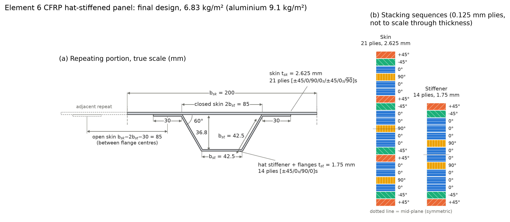
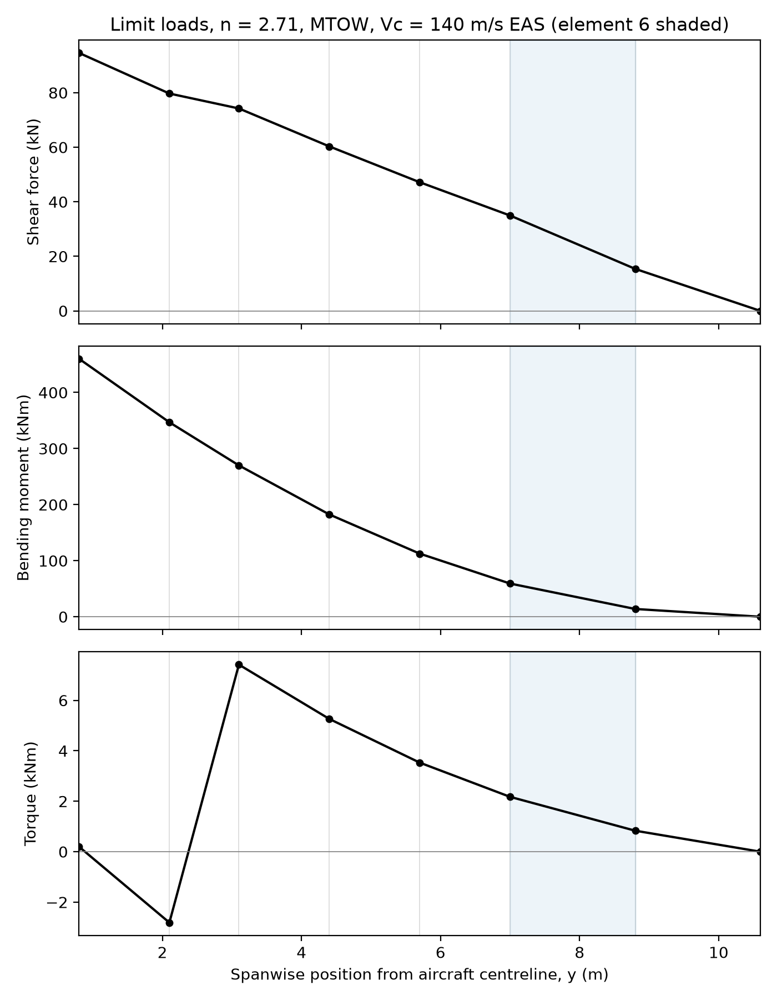
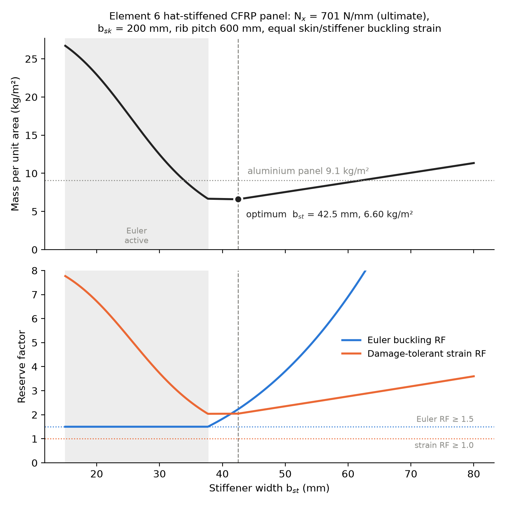

# Wing Panel Design: SAAB 340, element 6

ME32012 Aircraft Performance and Design coursework (University of Bath), Group E.

The project designs a minimum-mass CFRP hat-stiffened compression panel for the upper wing skin at the inboard edge of element 6 (y = 7.0 m) of a SAAB 340. It has two parts:

- **Part (i):** build the wing element geometry and work out the limit shear force, bending moment and torque along the semi-span for the maximum-g manoeuvre (strip method).
- **Part (ii):** convert the bending moment at the design station into an ultimate end load N<sub>x</sub>, find the continuous minimum-mass panel, then turn it into buildable laminates with valid stacking sequences.

## Final design



| | Skin | Hat stiffener and flanges |
|---|---|---|
| Plies (0 / ±45 / 90) | 21 (10 / 8 / 3) | 14 (8 / 4 / 2) |
| Thickness | 2.625 mm | 1.750 mm |
| Breakdown | 48 / 38 / 14 % | 57 / 29 / 14 % |
| Stacking sequence | [±45/0/90/0₂/±45/0₂/9̅0̅]s | [±45/0₃/90/0]s |
| Modulus (Krenchel) | 74.3 GPa | 83.6 GPa |

Geometry: stiffener width b<sub>st</sub> = 42.5 mm, pitch b<sub>sk</sub> = 200 mm, two 30 mm flanges, 60° webs, rib pitch 600 mm. The overbar marks a single 90° ply on the mid-plane.

| Failure mode | Critical N<sub>x</sub> (N/mm) | RF | Required |
|---|---|---|---|
| Skin between stiffeners | 706 | 1.01 | 1.00 |
| Skin under stiffener | 706 | 1.01 | 1.00 |
| Stiffener local buckling | 929 | 1.33 | 1.00 |
| Material strain (0.0045) | 1494 | 2.13 | 1.00 |
| Euler (overall, between ribs) | 1667 | 2.38 | 1.50 |

The applied ultimate end load is **N<sub>x</sub> = 701 N/mm**.

**Mass: 6.83 kg/m².** This is 25.0 % lighter than the 9.1 kg/m² aluminium panel, and 3.4 % heavier than the continuous optimum (6.60 kg/m²) because of rounding to whole plies.

## Results by stage

| Quantity | Value |
|---|---|
| Limit load factor, n (CS 25.337) | 2.71 |
| Limit BM at y = 7.0 m (strip method) | 59.20 kNm (57.95 kNm by exact integration) |
| Wing box at design station (0.4c × 0.12c) | 650 × 195 mm |
| Ultimate end load, N<sub>x</sub> | 701.0 N/mm |
| Continuous optimum (step 3) | b<sub>st</sub> = 42.5 mm, t<sub>sk</sub> = 2.670 mm, t<sub>st</sub> = 1.552 mm, 6.60 kg/m² |
| Naive ply rounding (step 4a) | 26-ply skin, 14-ply stiffener, 7.53 kg/m² |
| Discrete optimum (step 4b, final) | 21-ply skin, 14-ply stiffener, 6.83 kg/m² |




## Repository layout

| File | Purpose |
|---|---|
| `step1.py` | Element geometry: spanwise positions, chords and areas for elements 1 (root) to 7 (tip) |
| `step2_loads.py` | Element loads (lift, wing weight, fuel, engine) and limit SF/BM/T accumulated from tip to root |
| `step3_panel.py` | Hat-stiffened panel model, b<sub>st</sub> sweep, continuous optimum and validation checks |
| `step4_laminate.py` | Discrete laminate search, b<sub>st</sub> re-optimisation and stacking-sequence generation |
| `step5_section.py` | To-scale cross-section and ply-stack figure of the final design |
| `safe_save.py` | Writes outputs to a temporary file, then renames it over the target (see note below) |
| `loads_elements.csv` | Per-element geometry and limit loads (output of step 2) |
| `loads_sf_bm_t.csv` | Limit SF, BM and T at each element's inner boundary (output of step 2) |
| `panel_sweep.csv` | Minimum-thickness continuous design for each b<sub>st</sub> from 15 to 80 mm (output of step 3) |
| `final_design.json` | Final geometry, ply counts, stacking sequences, mass and RFs (output of step 4, input to step 5) |
| `fig_sf_bm_t.png` | Limit SF, BM and torque diagrams with element 6 shaded |
| `fig_panel_optimisation.png` | Panel mass and reserve factors against b<sub>st</sub> |
| `fig_cross_section.png` / `.svg` | Final design cross-section and stacking sequences |

## Running

Requires Python 3 with `numpy` 2.0 or later (for `np.trapezoid`), `pandas` and `matplotlib`.

```bash
pip install numpy pandas matplotlib
python step1.py           # geometry table and area check
python step2_loads.py     # loads -> loads_*.csv, fig_sf_bm_t.png
python step3_panel.py     # continuous optimum -> panel_sweep.csv, fig_panel_optimisation.png
python step4_laminate.py  # discrete design -> final_design.json
python step5_section.py   # reads final_design.json -> fig_cross_section.png/.svg
```

Each of steps 1 to 4 imports the step before it, so running a later step recomputes everything upstream. Step 5 reads `final_design.json` instead, so run step 4 first if anything changes. Run every script from the repository root, because inputs and outputs use relative paths.

All outputs are written through `safe_save.py`. The working folder is synced with OneDrive, which can mark old outputs as online-only. Writing over such a file on macOS can hang with `TimeoutError [Errno 60]`. Writing a fresh temporary file and renaming it over the target avoids that.

## Method

### Step 1: Geometry
- Straight-tapered wing from the body side (y = 0.8 m, c = 2.7 m) to the tip (y = 10.6 m, c = 1.0 m). The chord is constant through the fuselage.
- Element lengths come from Table 1 of the brief. Each element area uses its mean chord.

### Step 2: Limit loads (Butler notes pp. 11–15)
- Condition: maximum-g manoeuvre at V<sub>c</sub> = 140 m/s EAS and MTOW = 130.37 kN, with n = max(2.1 + 24000/(W + 10000), 2.5) = 2.71 (W in lb).
- Lift is distributed in proportion to element area and acts at 25 % chord.
- Wing weight (15 % of MTOW) and fuel act on the reference axis at 40 % chord, the centre of the 20–60 % chord wing box.
- The engine and main landing gear (4.5 kN) sit on element 2, 1.0 m ahead of the reference axis.
- Fuel is carried in elements 1, 3, 4 and 5, filled outboard first.
  - Tank capacity is the inter-spar box (0.4c × 0.12c × b) at SG 0.9.
  - That gives 10.11 kN of capacity per wing against 12.90 kN of fuel per wing, so all four tanks are full.
  - The 2.79 kN excess is taken as carried outside the wing. This is conservative for wing bending because it reduces inertia relief.
- Pitching moment per element combines the lift offset (0.15c), C<sub>M0</sub> = −0.08 and the engine moment.
- SF, BM and T are accumulated from tip to root and quoted at each element's inner boundary.
- Sign convention: shear and bending are positive for net upward load. Torque is positive leading edge up.
- Ultimate end load: N<sub>x</sub> = 1.5 M / (0.12c × 0.4c), using the chord at the design station.

### Step 3: Continuous optimisation (Butler notes pp. 21–23 and tips sheet)
- **Materials:** CFRP with E<sub>11</sub> = 130 GPa and ρ = 1600 kg/m³. Laminate moduli come from Krenchel factors, starting from target breakdowns of 44/44/12 for the skin and 60/30/10 for the stiffener. The damage-tolerant strain limit is 0.0045.
- **Failure modes checked:**
  - skin local buckling in the open bay (b<sub>sk</sub> − 2b<sub>st</sub> − b<sub>f</sub>) and the closed bay (2b<sub>st</sub>), with K = 2.23
  - stiffener local buckling, with K = 1.65
  - material strain, RF ≥ 1
  - Euler buckling between ribs, RF ≥ 1.5
- **Procedure:**
  1. For each b<sub>st</sub>, set t<sub>st</sub>/t<sub>sk</sub> so that skin and stiffener local buckling strains are equal.
  2. Bisect on thickness until every constraint is just met.
  3. Sweep b<sub>st</sub> from 15 to 80 mm and take the minimum of m = ρ(t<sub>sk</sub> + A<sub>st</sub>/b<sub>sk</sub>).

### Step 4: Discrete laminates (Butler p. 25)
- **Ply-count rules:**
  - plies are 0.125 mm thick, at 0, +45, −45 or 90° only
  - laminates are balanced and symmetric, so ±45 counts come in multiples of 4
  - 0 and 90 counts are even, except that one of them may be odd (a single mid-plane ply)
  - at least 10 % of each angle
  - each percentage is within 7 points of the target breakdown, the closest achievable at these thin gauges with ±45 in multiples of 4
- **Search:** every compliant skin (up to 4 mm) and stiffener (up to 2.6 mm) laminate is paired. Moduli are recomputed from the actual ply counts. For each pair, the lightest feasible b<sub>st</sub> is found on a 0.5 mm grid from 30 to 60 mm.
- **Stacking sequences:** a depth-first search produces a half-stack that, mirrored, meets every rule:
  - symmetric and balanced
  - no more than 3 adjacent plies of the same angle
  - a ±45 pair at both surfaces
  - every +45 next to a −45
- **Comparisons:** the script also reports naive per-orientation rounding (7.53 kg/m²) and a looser 10-point tolerance. The looser tolerance gives 6.72 kg/m², but the breakdowns drift further from the targets, so it is reported only as a sensitivity check.

### Step 5: Drawing
- One repeating portion is drawn to true scale and dimensioned. Hat centreline height = (√3/2) b<sub>st</sub> = 36.8 mm.
- The skin and stiffener stacks are drawn beside it, with each angle shown by both colour and hatching.

## Validation
- **Geometry:** element areas plus the fuselage rectangle reproduce S/2 = 20.29 m². This is asserted in `step1.py`.
- **Loads:** the strip-method bending moment at y = 7.0 m is within 2.2 % of an exact integration of the distributed load. The strip method gives the higher value, so it is conservative.
- **Panel model:** `props()` reproduces Butler's worked example, and `step3_panel.py` asserts this. The neutral axis z̄ = 9.44 mm matches exactly, and the local-buckling and strain RFs match to 2 d.p. Butler quotes EI = 16.4 × 10⁶, but his own p. 23 expression gives 16.7 × 10⁶ for the same inputs, so the Euler RF here is 0.95 rather than 0.94.
- **Continuous optimum:** a brute-force grid over (t<sub>sk</sub>, t<sub>st</sub>), without the equal-strain rule, finds 6.604 kg/m² at the same b<sub>st</sub>.
- **Discrete design:** `step4_laminate.py` asserts that both stacking sequences pass every rule and that the final panel satisfies all five constraints.

## Limitations
- Only the compression (upper) panel at one station, in one load case, is designed.
- Stiffener pitch, flange width and rib spacing are fixed rather than optimised.
- Laminate moduli use the Krenchel efficiency factor, not classical laminate theory, so bending–twisting coupling from the stacking sequence is ignored.
